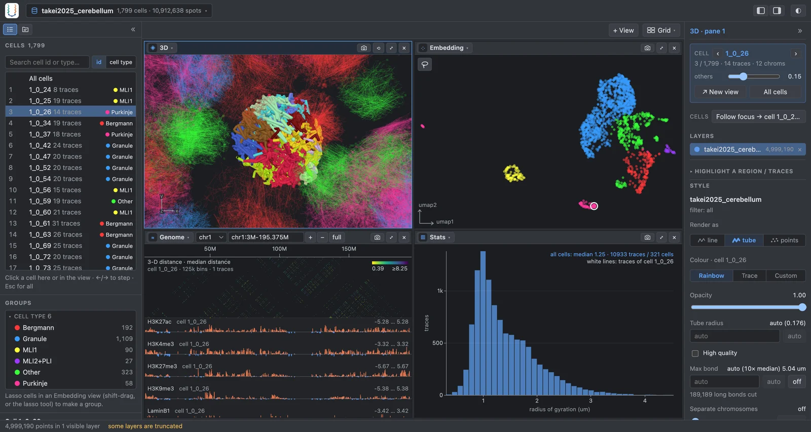

<p align="center"></p>

<h1 align="center">U-Chrom</h1>

<p align="center"><b>Universal Chromatin</b> — one toolkit for 3-D genome data from sequencing and imaging.</p>

<p align="center">
  <a href="https://u-chrom-docs.u-science.org">Documentation</a> ·
  <a href="https://uchrom-browser.u-science.org">Web browser (no install)</a> ·
  <a href="https://uchrom-atlas.u-science.org">Data atlas</a> ·
  <a href="tutorials/">Tutorials</a> ·
  <a href="LICENSE">MIT license</a>
</p>


<p align="center"><sub>The web browser on DNA seqFISH+ data of the mouse cerebellum (Takei et al. 2025, from the atlas): one selected Purkinje cell, shown in every view at once.</sub></p>

## What is U-Chrom?

Chromatin tracing, DNA seqFISH+, single-cell, spatial and bulk Hi-C all describe how the genome is
folded in 3-D — cell by cell — but each comes with its own formats and tools. U-Chrom puts them in
**one data model**, `ChromData` (stored as `.chromdata.zarr`, read from disk or over HTTP one cell
at a time), and builds the analyses, a web browser and a public data atlas on top of it.

| You have… | U-Chrom gives you |
|---|---|
| **Chromatin tracing** (FOF-CT, PyHiM) | spot-to-trace alignment, imputation (`uc.pp`); TADs, loops, compartments from 3-D distances (`uc.tl.call_tads` / `call_loops` / `call_compartments`) |
| **Imaging multi-omics** (DNA seqFISH+) | spots, chromatin marks and RNA of thousands of cells in one store; cell types, embeddings |
| **Single-cell Hi-C** | per-cell contact maps, single-cell boundaries and A/B, pseudo-bulk, cell embeddings (FastHigashi), 3-D structures (EMber, NucDynamics) |
| **Spatial Hi-C** | per-spot contact maps placed in the tissue, with RNA and images; spatial statistics |
| **Bulk Hi-C** | HiCCUPS / Mustache loops, compartments, 3-D models (MDS, IGM populations, GEM-FISH with imaging) |

## Try it without installing

- **[uchrom-browser.u-science.org](https://uchrom-browser.u-science.org)** — the web browser on the atlas datasets.
- **[uchrom-atlas.u-science.org](https://uchrom-atlas.u-science.org)** — 22 public datasets (spatial Hi-C, single-cell Hi-C with RNA / ATAC, DNA seqFISH+) as stores you also open by name from Python.

## Install

Python ≥ 3.11. The packages are installed from this repository (not on PyPI yet):

```bash
git clone https://github.com/u-science-lab/U-Chrom.git && cd U-Chrom
uv pip install -e "packages/uchrom[web]"      # analysis library + data model + web browser
# or: pip install -e packages/chromdata -e packages/uchrom-browser -e packages/uchrom
```

Optional components (add them in the brackets, e.g. `"packages/uchrom[web,recon]"`):

| Extra | Adds | Needed for |
|---|---|---|
| `recon` | `uchrom-recon`, the native engine (Rust toolchain needed to build) | 3-D reconstruction: EMber, NucDynamics, IGM |
| `maps` | `uchrom-maps` (Rust) | fast HiCCUPS / Mustache loop calling on Hi-C maps |
| `emb` | FastHigashi (needs NumPy < 2) | `uc.tl.embed_higashi` |
| `hic` · `umap` · `plot3d` | hic-straw · umap-learn · PyVista | reading `.hic` · UMAP · 3-D plots in Python |

Details, GPU notes and an install check: [Installation](docs/source/start/install.md).

## Quick start

**1 · Open a dataset of the atlas** — read over HTTP, nothing to download first:

```python
import uchrom.datasets as ds

cd = ds.load("takei2025_cerebellum")      # DNA seqFISH+, mouse cerebellum
print(cd)
# ChromData (backed: takei2025_cerebellum.chromdata.zarr):
#   n_spots=10912638, n_traces=59112, n_cells=1799, n_bins=100049 …
cell = cd.get_cell(cd.cells.index[0])     # one cell: 4,183 spots, 24 traces, 62 tracks
```

**2 · Analyse** — chromatin tracing (Takei et al. 2021) → TADs from 3-D distances:

```python
import uchrom as uc

cd = ds.load("takei2021_mesc")            # built once from 4DN files (~23 MB): 201 cells
tads = uc.tl.call_tads(cd, chrom="chr3")  # ArcFISH; also stored in cd.results["tads.arcfish"]
cd.write("takei2021.chromdata.zarr")
```

**3 · Look** — open the result in the web browser (http://127.0.0.1:8765):

```bash
uchrom-browser takei2021.chromdata.zarr
```

Next: single-cell Hi-C → 3-D structures (`uc.tl.reconstruct_sc`, extra `recon`) in the
[reconstruction tutorial](tutorials/reconstruction.ipynb); cell embeddings from contact maps
(`uc.tl.embed_higashi`, extra `emb`) in the [Higashi tutorial](tutorials/higashi_embedding.ipynb);
all [tutorials](tutorials/README.md) run on real data.

## The data model in one picture

```text
ChromData
├── cells    one row per cell (cell type, position in the tissue, RNA, embeddings in cellm)
│   └── traces    one chromosome copy each (imaging) or one chromosome (sequencing)
│       └── spots     x, y, z of a locus, with per-spot tracks (chromatin marks, intensities)
├── bins     the shared locus axis: chrom, start, end — every modality is indexed on it
└── linked   contact maps (.cool / .scool), AnnData, images, … read on demand, per cell
```

A store opens *backed* — on disk or over HTTP — and reads one cell, trace or chromosome at a time,
so a 10-million-spot dataset opens in seconds. More: [Concepts](docs/source/start/concepts.md),
[Data model & storage](docs/source/data/index.md), [format spec](packages/chromdata/spec.md).

## API at a glance

| Module | What | Examples |
|---|---|---|
| `uchrom.datasets` | the atlas and every tutorial dataset | `ds.load`, `ds.fetch`; `python -m uchrom.datasets list` / `atlas` |
| `uchrom.io` | readers and writers | `read_pairs`, `load_cool`, `read_seqfish_multiomics`, `write_fofct`; `ChromData.from_fofct` |
| `uc.pp` | imaging preprocessing | `align_spots`, `impute`, `merge_duplicate_spots` |
| `uc.tl` | structures, reconstruction, embeddings | `call_tads`, `call_loops`, `call_compartments`, `single_cell_boundaries`, `pseudobulk`, `reconstruct_sc`, `reconstruct_bulk`, `embed_cells`, `embed_higashi`, `cluster_cells` |
| `uchrom.pl` | plots (matplotlib) | `plot_contact_map`, `plot_distance_matrix`, `plot_spatial`, `plot_structure_3d` |
| `uchrom_browser` | the web browser, also driven from Python | `uchrom-browser data.chromdata.zarr`; `ub.connect()` |

`uc.pp` and `uc.tl` come with `import uchrom as uc`; import `uchrom.io` and `uchrom.pl` explicitly.
Full reference: [API](docs/source/reference/api/index.md).

## Datasets

```bash
python -m uchrom.datasets atlas     # the 22 public stores of the atlas (read over HTTP)
python -m uchrom.datasets list      # tutorial datasets, fetched from their original sources
```

No data are stored in this repository: datasets come from the atlas or from their original
sources, cached under `$UCHROM_DATA` (default `~/.cache/uchrom`). How each one is built:
[`apps/atlas/recipes/`](apps/atlas/recipes/README.md).

## From scripts and AI agents

- **Drive the browser from Python** — `ws = uchrom_browser.connect()` reads the cells you
  lasso-selected, opens and arranges views, and saves any view as PNG, SVG or PDF
  (`ws.capture(path="fig.svg")`); the same actions are exposed to in-browser agents through WebMCP.
  See [The web browser](docs/source/viz/browser.md).
- **Agent skills** — [`skills/`](skills/README.md) holds skills for coding agents (load data, call
  structures, compare groups, associate modalities, show results in the browser); copy a skill
  folder into `.claude/skills/` to use it.
- **Auto-discovery** (experimental, not in the documentation yet) — `packages/uchrom-discovery`:
  LLM agents that propose, run and check analyses on a dataset.

## Documentation

[u-chrom-docs.u-science.org](https://u-chrom-docs.u-science.org) — one chapter per kind of data,
each with tutorials on real data:

- **Getting started** — [install](docs/source/start/install.md) · [quickstart](docs/source/start/quickstart.md) · [concepts](docs/source/start/concepts.md)
- **By data type** — [chromatin tracing](docs/source/tracing/index.md) · [DNA seqFISH+](docs/source/seqfish/index.md) · [single-cell & spatial Hi-C](docs/source/schic/index.md) · [bulk Hi-C](docs/source/bulk/index.md)
- **Common to all data** — [datasets & atlas](docs/source/datasets/index.md) · [data model](docs/source/data/index.md) · [features](docs/source/features/index.md) · [visualisation](docs/source/viz/index.md)
- **Reference** — [API](docs/source/reference/api/index.md) · [file formats](docs/source/reference/formats.md) · [development](docs/source/reference/development.md)

## Repository layout

| Folder | Package (import) | What it is |
|---|---|---|
| `packages/chromdata/` | `chromdata` | the data model and the `.chromdata.zarr` store (numpy / pandas / zarr / pyarrow only) |
| `packages/uchrom/` | `u-chrom` (`uchrom`) | the analysis library: I/O, imaging, structures, reconstruction, features, embeddings, plots |
| `packages/uchrom-browser/` | `uchrom-browser` (`uchrom_browser`) | the web browser (needs `chromdata` only); command `uchrom-browser` |
| `packages/uchrom-recon/` | `uchrom-recon` | native reconstruction engine: NucDynamics, EMber, IGM (Rust; LGPL-3.0) |
| `packages/uchrom-maps/` | `uchrom-maps` | native Hi-C map kernels: HiCCUPS, Mustache (Rust) |
| `packages/uchrom-discovery/` | `uchrom-discovery` | LLM-driven auto-discovery (Python ≥ 3.10); command `uchrom-discovery` |
| `apps/` | — | the atlas (site, publishing, dataset recipes) and the hosted web browser |
| `tutorials/`, `docs/`, `skills/`, `benchmarks/` | — | notebooks, documentation, agent skills, benchmarks |

## Development

Each package has its own tests (`cd packages/<package> && pytest tests`; the browser front end:
`npm test` in `packages/uchrom-browser/uchrom_browser/frontend`). See
[development](docs/source/reference/development.md).

## License

MIT ([LICENSE](LICENSE)); `packages/uchrom-recon` is LGPL-3.0-or-later. Third-party code and
re-implementations: [license notes](docs/source/reference/license.md).
