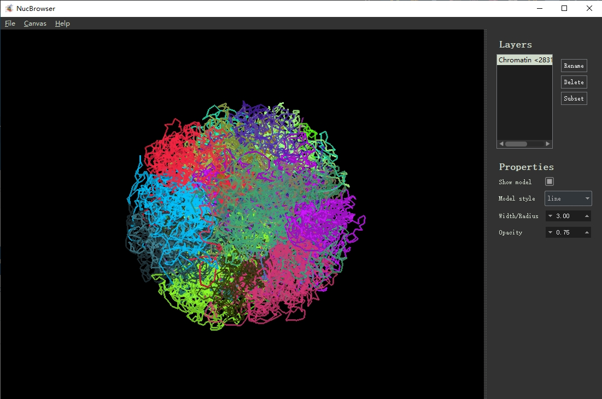

# U-Chrom

**U**niversal **Chrom**atin structure data analysis toolkit.

U-Chrom provides a unified framework for chromatin 3D structure analysis. The core data structure is a **structure table** — genomic bins mapped to 3D coordinates (x, y, z). This table can be obtained from:

- **Sequencing-based data** (Hi-C, Dip-C, etc.) via 3D reconstruction algorithms
- **Imaging-based data** (DNA FISH, chromatin tracing, etc.) via image processing and chromatin tracing

Based on this core data structure, U-Chrom supports a range of downstream analyses:

- Reconstruct distance matrices from 3D coordinates
- Identify chromatin structures (A/B compartments, TADs, loops)
- Embed single-cell structures for population-level analysis
- Compute geometric features
- Interactive 3D visualization

## Modules

| Module | Description |
|--------|-------------|
| `uchrom.io` | Read/write standard formats (.pairs, .cool, .hic, .3dg, .csv, .pdb) |
| `uchrom.recon.sc` | Single-cell 3D reconstruction (Nuc Dynamics, GEM) |
| `uchrom.recon.bulk` | Bulk Hi-C 3D reconstruction (MDS/SMACOF) |
| `uchrom.recon.fish` | Reconstruction combining sequencing and imaging data |
| `uchrom.im` | Image processing for chromatin tracing data |
| `uchrom.strc` | Structure identification (TAD, loop, compartment) |
| `uchrom.fea` | Geometric feature computation |
| `uchrom.emb` | Single-cell structure embedding |
| `uchrom.pl` | Plotting utilities |
| `uchrom.browser` | Interactive 3D structure browser |

LLM-driven multi-omics auto-discovery lives in the separate
[`uchrom-discovery`](discovery/README.md) package (`pip install -e discovery/`).

## Install

```bash
$ pip install u-chrom
```

Optional extras:
```bash
$ pip install "u-chrom[browser]"   # interactive 3D browser (PyVista + PyQt5)
$ pip install "u-chrom[hic]"       # read .hic files
$ pip install "u-chrom[anndata]"   # link ChromData with AnnData
```

Install from source:

```bash
$ git clone https://github.com/Nanguage/U-Chrom.git
$ cd U-Chrom
$ pip install -e .
```

## Usage

### Single-cell 3D reconstruction

```bash
$ pip install ./native/nucdyn   # native NucDynamics engine (Rust; CPU + GPU)
$ python -m uchrom.recon.sc.nucdyn example-data/cell1.pairs ./cell1.chromdata.zarr --n_models=10 --device=auto
```

### Bulk Hi-C 3D reconstruction

```bash
$ python -m uchrom.recon.bulk.mds ./data.mcool ./out.csv --resolution=100000 --chrom=chr1
```

### Visualize the reconstructed structure

```bash
$ python -m uchrom.browser ./out1.csv
```



### Convert to PDB format (for PyMol / VMD)

```bash
$ python -m uchrom.io particles_to_pdb ./out1.csv ./out1.pdb --split-by-chrom=True
```
